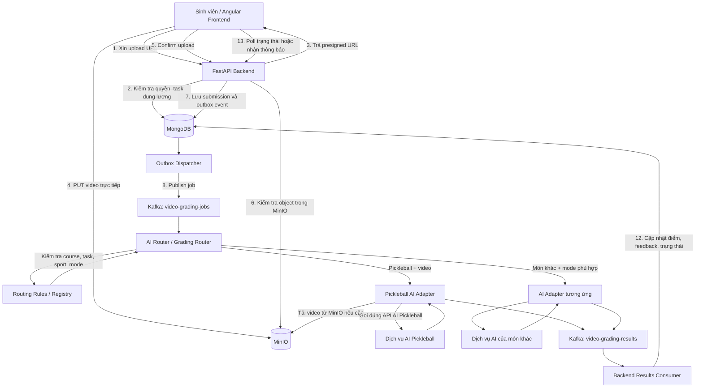
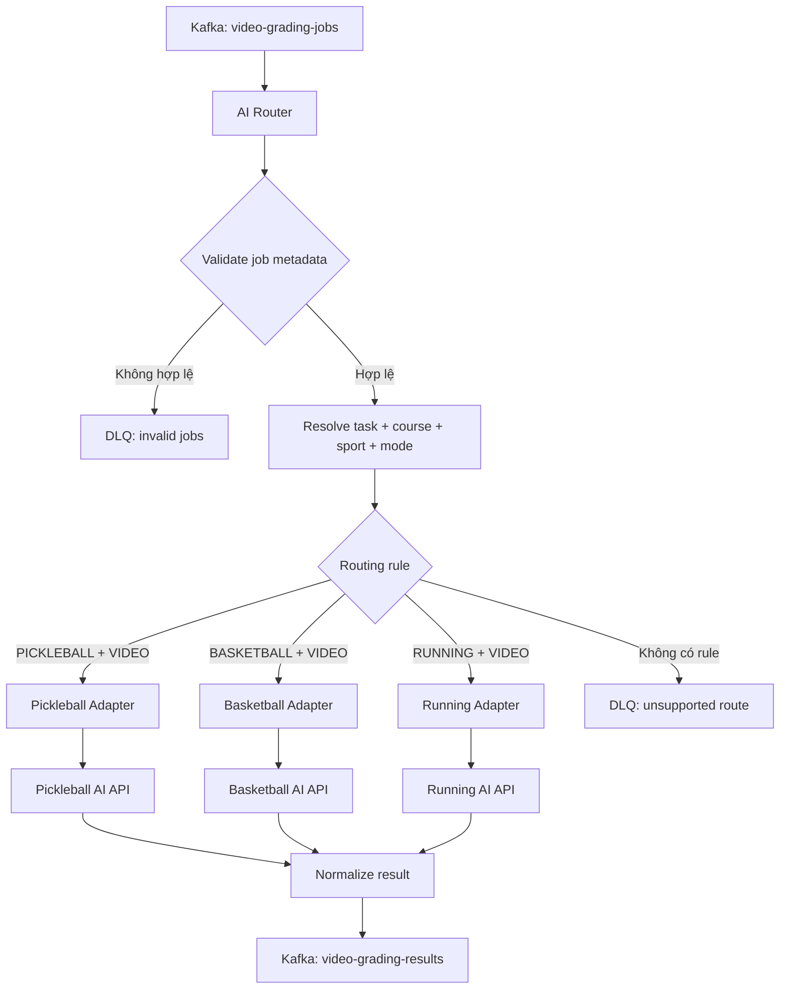

# Thiết kế luồng upload video và chấm điểm AI

## 1. Mục tiêu

Thiết kế luồng để sinh viên tải video bài tập lên hệ thống, backend kiểm tra quyền và thông tin bài tập, video được lưu trong MinIO, sau đó dịch vụ AI xử lý video và trả kết quả về hệ thống.

Thiết kế đề xuất sử dụng **upload trực tiếp từ frontend lên MinIO bằng presigned URL**, kết hợp với **MongoDB** để lưu metadata và trạng thái, **Kafka** để điều phối công việc bất đồng bộ.

### Vì sao chọn cách này?

- Video không phải đi qua backend API nên giảm tải RAM, CPU và băng thông cho backend.
- Có thể xử lý video lớn tốt hơn so với việc đọc toàn bộ file vào RAM bằng `await file.read()`.
- Việc chấm điểm AI chạy bất đồng bộ; frontend không phải giữ request upload mở cho đến khi AI xử lý xong.
- Kafka giúp tách biệt backend nhận bài và worker AI.
- Có thể theo dõi trạng thái xử lý và cho phép retry khi gặp lỗi.

## 2. Kiến trúc tổng thể



> Nếu dịch vụ AI hiện đã tự consume topic `video-grading-jobs`, không cần tạo thêm một consumer trùng chức năng. Chỉ cần bảo đảm đúng một thành phần chịu trách nhiệm lấy video từ MinIO, gọi inference và phát kết quả.


## 3.1. Thiết kế Router cho nhiều môn học

### Nguyên tắc

Router là một consumer/service độc lập đọc topic `video-grading-jobs`. Nó không nên chứa toàn bộ logic inference của từng môn; nhiệm vụ chính là **validate metadata → resolve routing rule → dispatch đến adapter phù hợp → chuẩn hóa kết quả**.

Luồng đề xuất:



### Metadata cần có trong Kafka job

Backend nên gửi đủ thông tin để Router định tuyến. Ví dụ:

```json
{
  "job_id": "job_001",
  "result_id": "result_abc123",
  "task_id": "task_pickleball_01",
  "course_id": "course_2026_A",
  "sport_id": "sport_pickleball",
  "sport_code": "PICKLEBALL",
  "mode": "VIDEO",
  "bucket": "videos",
  "object_key": "submissions/task_pickleball_01/result_abc123.mp4",
  "user_id": "student_001",
  "attempt": 1,
  "schema_version": 1
}
```

`course_id`, `task_id`, `sport_id` và `mode` phải được backend lấy từ dữ liệu đã xác thực trong database, không chỉ sao chép các giá trị do frontend gửi lên. Router nên xác minh lại các trường quan trọng bằng dữ liệu cấu hình hoặc registry tin cậy.

### Điều kiện định tuyến

| Điều kiện | Adapter đích |
|---|---|
| `sport_code=PICKLEBALL` và `mode=VIDEO` | `pickleball_video` |
| `sport_code=BASKETBALL` và `mode=VIDEO` | `basketball_video` |
| `sport_code=RUNNING` và `mode=VIDEO` | `running_video` |
| `sport_code=PICKLEBALL` nhưng `mode` không được hỗ trợ | Từ chối route, ghi lỗi có cấu trúc |
| `task_id` không tồn tại hoặc không khớp `course_id`/`sport_id` | Đưa vào DLQ hoặc đánh dấu job không hợp lệ |
| Không có mapping cho môn/mode | Đưa vào DLQ `unsupported_route` |

Nên dùng ID/code ổn định như `PICKLEBALL`, `BASKETBALL`, `RUNNING`, `VIDEO`, thay vì so sánh tên hiển thị như “Môn Pickleball” vì tên có thể đổi hoặc khác ngôn ngữ.

### Cấu hình routing thay vì hard-code

Với số lượng môn tăng dần, nên quản lý routing bằng config hoặc một collection trong MongoDB. Ví dụ:

```yaml
routes:
  - sport_code: PICKLEBALL
    mode: VIDEO
    adapter: pickleball_video
    enabled: true
    timeout_seconds: 120

  - sport_code: BASKETBALL
    mode: VIDEO
    adapter: basketball_video
    enabled: true
    timeout_seconds: 120

  - sport_code: RUNNING
    mode: VIDEO
    adapter: running_video
    enabled: true
    timeout_seconds: 180
```

Đây là ví dụ cấu hình; endpoint, timeout và adapter thực tế cần khớp với dịch vụ đang triển khai. Không commit API key/secret vào Git; dùng environment variables hoặc secret manager.

Nếu task có thể ghi đè cấu hình course/sport, cần định nghĩa thứ tự ưu tiên rõ ràng. Gợi ý:

1. Kiểm tra `task_id` tồn tại và thuộc `course_id`.
2. Lấy mode được phép từ task/course.
3. Xác định môn học chuẩn từ task/course.
4. So sánh `sport_id` trong job với dữ liệu chuẩn để phát hiện metadata không khớp.
5. Chọn route theo rule cụ thể nhất, chẳng hạn task override course, course override sport, nhưng chỉ khi nghiệp vụ cho phép.
6. Nếu thiếu hoặc mâu thuẫn thông tin, không tự đoán API; đánh dấu lỗi và đưa vào DLQ.

### Pseudocode cho Router

```python
async def route_grading_job(job: dict) -> None:
    validate_required_fields(job)

    task = await repository.get_task(job["task_id"])
    if task is None:
        await publish_dead_letter(job, reason="task_not_found")
        return

    course = await repository.get_course(job["course_id"])
    if course is None:
        await publish_dead_letter(job, reason="course_not_found")
        return

    # Resolve metadata từ dữ liệu tin cậy, không chỉ tin Kafka payload.
    resolved = resolve_grading_context(task=task, course=course)

    if resolved.sport_code != job["sport_code"]:
        await publish_dead_letter(job, reason="sport_mismatch")
        return

    if resolved.mode != job["mode"]:
        await publish_dead_letter(job, reason="mode_mismatch")
        return

    route = await route_registry.find(
        sport_code=resolved.sport_code,
        mode=resolved.mode,
        task_id=resolved.task_id,
        course_id=resolved.course_id,
    )

    if route is None or not route.enabled:
        await publish_dead_letter(job, reason="unsupported_route")
        return

    adapter = adapter_registry.get(route.adapter)
    if adapter is None:
        await publish_dead_letter(job, reason="adapter_not_registered")
        return

    result = await adapter.grade(job)
    await publish_grading_result(normalize_result(job, result))
```

Đây là pseudocode định hướng kiến trúc, chưa phải implementation hoàn chỉnh. Cần bổ sung exception handling, timeout, retry, idempotency và cách commit Kafka offset phù hợp.

## 3.2. Adapter cho từng AI API

Mỗi AI API có thể có request/response khác nhau. Để Router không phải biết chi tiết từng API, tạo adapter interface chung:

```python
from typing import Protocol, Any

class GradingAdapter(Protocol):
    async def grade(self, job: dict[str, Any]) -> dict[str, Any]:
        ...
```

Adapter Pickleball sẽ:

1. Nhận job đã được Router xác nhận là `PICKLEBALL + VIDEO`.
2. Đọc `bucket` và `object_key` để tải video từ MinIO, hoặc tạo URL có thời hạn ngắn nếu API AI nhận URL.
3. Gọi đúng endpoint Pickleball AI theo request schema của API đó.
4. Chuyển response riêng của Pickleball thành schema kết quả chung.
5. Trả lỗi có phân loại nếu timeout, API trả lỗi hoặc video không hợp lệ.

Các adapter khác thực hiện tương tự nhưng dùng endpoint và payload riêng. Tránh để Router chứa các nhánh HTTP phức tạp cho mọi môn.

Schema kết quả chung gợi ý:

```json
{
  "job_id": "job_001",
  "result_id": "result_abc123",
  "sport_code": "PICKLEBALL",
  "mode": "VIDEO",
  "status": "completed",
  "score": 8.5,
  "feedback": "Thực hiện động tác tương đối chính xác.",
  "metrics": {
    "accuracy": 0.85
  },
  "error": null
}
```

Nếu các môn có kết quả chuyên biệt, giữ phần chung như `job_id`, `result_id`, `sport_code`, `status`, `error`; phần chi tiết đặt trong `metrics` hoặc `details` theo schema/version được định nghĩa rõ ràng.

## 3.3. Kafka topic và xử lý lỗi của Router

| Topic | Mục đích |
|---|---|
| `video-grading-jobs` | Job mới từ backend |
| `video-grading-results` | Kết quả chuẩn hóa trả về backend |
| `video-grading-dlq` | Job sai metadata hoặc không có route |
| `video-grading-retry` *(tùy chọn)* | Job cần retry theo chính sách riêng |

Không nhất thiết phải có topic retry riêng ngay từ đầu; có thể dùng retry topic hoặc cơ chế retry của worker tùy hạ tầng. Tránh retry vô hạn làm nghẽn partition.

Các quy tắc quan trọng:

- Dùng `job_id` ổn định và lưu trạng thái xử lý để chống gọi AI API nhiều lần khi Kafka redeliver.
- Đặt timeout cho mỗi adapter.
- Retry lỗi tạm thời như timeout hoặc HTTP 5xx với backoff và giới hạn số lần.
- Không retry lỗi nghiệp vụ vĩnh viễn như `unsupported_route`, `task_not_found`, `mode_mismatch`.
- Sau khi hết retry, phát kết quả `failed` hoặc đưa job vào DLQ để quan sát và xử lý thủ công.
- Chỉ commit Kafka offset theo cách phù hợp với khả năng phục hồi; không đánh dấu job đã xử lý trước khi đã lưu được kết quả hoặc có cơ chế bảo đảm khôi phục.
- Nếu AI API hỗ trợ idempotency key, truyền `job_id` hoặc `result_id` để giảm nguy cơ chấm điểm trùng.

## 3.4. Router nên xác minh điều kiện ở đâu?

- **Backend khi upload/confirm:** kiểm tra quyền người dùng, task/course, số lượt nộp, trạng thái task và mode được phép; tạo job từ metadata chuẩn.
- **AI Router:** kiểm tra metadata có đủ và nhất quán; resolve route theo `sport + mode` và các rule task/course; từ chối job không hợp lệ hoặc không được hỗ trợ.
- **AI Adapter/service:** kiểm tra đầu vào chuyên biệt của API, tải video nếu cần, gọi inference và chuẩn hóa kết quả.
- **Backend Results Consumer:** xác minh `result_id` tồn tại, kết quả thuộc đúng job, sau đó cập nhật MongoDB.

Không nên chỉ dựa vào `course_id` để quyết định môn học nếu một course có thể chứa nhiều task/môn. Hãy dùng dữ liệu chuẩn của task/course và quy tắc nghiệp vụ đã thống nhất.


## 3. Thành phần và trách nhiệm

| Thành phần | Trách nhiệm |
|---|---|
| Angular Frontend | Xin URL upload, upload video lên MinIO, xác nhận upload và hiển thị trạng thái |
| FastAPI Backend | Xác thực sinh viên, kiểm tra task/quyền/số lần nộp, tạo presigned URL, xác nhận upload, lưu metadata |
| MinIO | Lưu file video; bucket nên để private |
| MongoDB | Lưu submission, trạng thái, điểm, feedback và outbox event |
| Kafka `video-grading-jobs` | Topic đầu vào chung cho các job chấm điểm |
| AI Router / Grading Router | Consume job, kiểm tra course/task/sport/mode và chọn adapter AI phù hợp |
| Routing Rules / Registry | Cấu hình mapping giữa môn học + mode và AI adapter/API |
| AI Adapter | Chuẩn hóa cách gọi từng AI API; có thể tải file từ MinIO hoặc gửi URL/file theo hợp đồng API |
| AI services | Xử lý nghiệp vụ riêng của từng môn, ví dụ Pickleball AI, Basketball AI, Running AI |
| Kafka `video-grading-results` | Chuyển kết quả xử lý về backend |
| Results Consumer | Cập nhật kết quả cuối cùng vào MongoDB |

## 4. Luồng xử lý chi tiết

### Bước 1 — Frontend xin presigned URL

Frontend gọi:

```http
POST /video-results/upload-url
Authorization: Bearer <access_token>
Content-Type: application/json
```

Request mẫu:

```json
{
  "task_id": "task_123",
  "filename": "practice.mp4",
  "content_type": "video/mp4",
  "file_size": 125000000
}
```

Backend cần:

1. Xác thực token và lấy `user_id` từ token, không tin `student_id` do frontend gửi lên.
2. Kiểm tra task có tồn tại và thuộc đúng course/sport.
3. Kiểm tra task còn mở, sinh viên có quyền nộp và còn lượt nộp.
4. Kiểm tra định dạng, dung lượng khai báo và các giới hạn của hệ thống.
5. Sinh `result_id`/`upload_id` và object key duy nhất.
6. Tạo presigned URL có thời hạn ngắn, ví dụ 10 phút.
7. Lưu một upload session trong MongoDB với trạng thái `uploading`.

Ví dụ object key:

```text
submissions/{task_id}/{result_id}.mp4
```

Response mẫu:

```json
{
  "upload_id": "upload_abc123",
  "result_id": "result_abc123",
  "object_key": "submissions/task_123/result_abc123.mp4",
  "upload_url": "https://minio.example.com/...",
  "expires_in": 600
}
```

Lưu ý: `upload_url` là URL có chữ ký và có quyền ghi vào đúng object đã chỉ định. Không trả MinIO access key hoặc secret key cho frontend.

### Bước 2 — Frontend upload trực tiếp lên MinIO

Frontend dùng presigned URL để PUT file:

```typescript
async function uploadVideo(uploadUrl: string, file: File): Promise<void> {
  const response = await fetch(uploadUrl, {
    method: "PUT",
    headers: {
      "Content-Type": file.type || "application/octet-stream",
    },
    body: file,
  });

  if (!response.ok) {
    throw new Error(`Upload failed: ${response.status}`);
  }
}
```

Các điều kiện cần đáp ứng:

- URL MinIO trong presigned URL phải truy cập được từ trình duyệt của sinh viên.
- Cấu hình CORS của bucket/MinIO cho phép origin của frontend, phương thức `PUT` và các header cần thiết.
- CORS chỉ cho phép trình duyệt gọi endpoint; nó **không** làm endpoint MinIO tự động truy cập được từ Internet.
- `Content-Type` khi upload phải phù hợp với thông tin dùng để ký URL nếu chữ ký có ràng buộc header.
- Với video lớn hoặc mạng không ổn định, cân nhắc multipart upload/resumable upload để hỗ trợ retry.
- Không coi `file_size` từ frontend là dữ liệu đáng tin cậy; backend phải kiểm tra lại sau upload.

### Bước 3 — Frontend xác nhận upload hoàn tất

Sau khi PUT thành công, frontend gọi:

```http
POST /video-results/confirm-upload
Authorization: Bearer <access_token>
Content-Type: application/json
```

Request:

```json
{
  "upload_id": "upload_abc123"
}
```

Backend cần:

1. Tìm upload session theo `upload_id`.
2. Xác minh session thuộc đúng sinh viên đang đăng nhập.
3. Lấy `task_id`, `result_id`, bucket và object key từ session phía server; không tin object key do client tự gửi.
4. Gọi MinIO `stat_object` để xác nhận object tồn tại và lấy kích thước thực tế.
5. Kiểm tra dung lượng, loại file và các quy tắc nghiệp vụ cần thiết.
6. Chống xác nhận trùng: nếu submission đã được confirm thì trả kết quả hiện có, không tạo job mới.
7. Cập nhật submission sang trạng thái chờ xử lý và ghi sự kiện vào outbox.

Chỉ phát job AI sau khi backend xác nhận file đã tồn tại và hợp lệ.

### Bước 4 — Lưu metadata và trạng thái trong MongoDB

Ví dụ document submission:

```json
{
  "_id": "result_abc123",
  "taskId": "task_123",
  "userId": "student_001",
  "bucket": "videos",
  "objectKey": "submissions/task_123/result_abc123.mp4",
  "status": "pending",
  "score": null,
  "feedback": null,
  "metrics": null,
  "createdAt": "2026-10-15T10:00:00Z",
  "updatedAt": "2026-10-15T10:00:00Z"
}
```

Nên chuẩn hóa trạng thái thành một trường `status` thay vì chỉ dùng boolean `pending`, vì boolean không thể phân biệt rõ đang chờ, đang xử lý hay thất bại.

Các trạng thái đề xuất:

- `uploading`: đang trong quá trình upload.
- `pending`: upload hoàn tất, đang chờ worker.
- `processing`: worker đã nhận job và đang xử lý.
- `completed`: đã có kết quả.
- `failed`: xử lý thất bại và không còn retry tự động.
- `expired`: upload session hết hạn mà chưa hoàn tất.

Nếu hệ thống hiện tại đã dùng `pending`, có thể giữ tương thích trong giai đoạn chuyển đổi rồi mới bỏ trường này.

### Bước 5 — Đưa job vào Kafka

Không gửi nội dung video qua Kafka. Chỉ gửi metadata và tham chiếu đến object trong MinIO.

Ví dụ message của topic `video-grading-jobs`:

```json
{
  "job_id": "job_001",
  "result_id": "result_abc123",
  "task_id": "task_123",
  "sport_id": "sport_pickleball",
  "sport_code": "PICKLEBALL",
  "user_id": "student_001",
  "bucket": "videos",
  "object_key": "submissions/task_123/result_abc123.mp4",
  "attempt": 1
}
```

#### Tránh lỗi MongoDB đã lưu nhưng Kafka chưa nhận job

Nếu backend lưu submission thành công nhưng publish Kafka thất bại, submission có thể bị kẹt ở `pending`.

Giải pháp khuyến nghị: **Transactional Outbox**.

1. Trong cùng thao tác ghi MongoDB, lưu submission và một outbox event.
2. Một dispatcher riêng đọc các outbox event chưa gửi.
3. Dispatcher publish event lên Kafka.
4. Chỉ đánh dấu event đã gửi sau khi publish thành công.
5. Nếu lỗi, dispatcher retry theo chính sách có giới hạn và log rõ ràng.

Outbox không làm MongoDB và Kafka trở thành một transaction chung, nhưng giúp tránh mất job khi backend gặp lỗi giữa hai thao tác.

### Bước 6 — Router chọn AI API và Adapter xử lý job

AI Router consume `video-grading-jobs`, xác minh metadata `task/course/sport/mode`, sau đó tra routing registry để chọn adapter phù hợp. Ví dụ `PICKLEBALL + VIDEO` được chuyển đến Pickleball Adapter; `BASKETBALL + VIDEO` được chuyển đến Basketball Adapter.

Adapter tương ứng tải video từ MinIO nếu cần, gọi AI API theo request schema riêng, áp dụng timeout/retry và chuẩn hóa response. Chi tiết thiết kế Router, adapter, routing rules và DLQ được mô tả ở mục **3.1–3.4**.

Nếu dịch vụ AI đã tự consume `video-grading-jobs`, cần chọn rõ một mô hình: để AI service tự định tuyến hoặc để Router/Adapter làm việc đó. Không để cả hai cùng consume và xử lý cùng một job ngoài ý muốn.

### Bước 7 — AI gửi kết quả về Kafka

Ví dụ message của topic `video-grading-results`:

```json
{
  "job_id": "job_001",
  "result_id": "result_abc123",
  "status": "completed",
  "score": 8.5,
  "feedback": "Thực hiện động tác tương đối chính xác.",
  "metrics": {
    "accuracy": 0.85
  }
}
```

Khi thất bại, worker nên phát message có trạng thái `failed` cùng mã lỗi/thông tin lỗi đã được làm sạch, hoặc gửi vào dead-letter topic sau khi hết retry. Không gửi thông tin bí mật hoặc dữ liệu nhạy cảm không cần thiết vào log/message.

### Bước 8 — Backend lưu kết quả

Backend Results Consumer đọc `video-grading-results` và cập nhật submission tương ứng:

- `status = completed`
- Lưu `score`, `feedback`, `metrics`
- Cập nhật `updatedAt`
- Đánh dấu job đã được xử lý

Nếu nhận kết quả trùng, consumer cần xử lý idempotent để không ghi nhận điểm hoặc side effect nhiều lần. Nếu nhận `failed`, cập nhật `status = failed` và lưu thông tin lỗi phù hợp; không để submission ở `pending` mãi mãi.

### Bước 9 — Frontend hiển thị trạng thái

Frontend có thể gọi API trạng thái định kỳ, ví dụ:

```http
GET /video-results/{result_id}
Authorization: Bearer <access_token>
```

Response khi đang xử lý:

```json
{
  "result_id": "result_abc123",
  "status": "processing"
}
```

Response khi hoàn tất:

```json
{
  "result_id": "result_abc123",
  "status": "completed",
  "score": 8.5,
  "feedback": "Thực hiện động tác tương đối chính xác."
}
```

Có thể dùng WebSocket hoặc Server-Sent Events nếu cần cập nhật tức thời. Với phiên bản đầu, polling có chu kỳ hợp lý thường đơn giản hơn.

## 5. API đề xuất

| API | Mục đích |
|---|---|
| `POST /video-results/upload-url` | Kiểm tra quyền và cấp presigned URL |
| `POST /video-results/confirm-upload` | Xác minh object đã upload và tạo job chấm điểm |
| `GET /video-results/{result_id}` | Lấy trạng thái, điểm và feedback |
| `GET /video-results` | Liệt kê các lần nộp của sinh viên, nếu nghiệp vụ cần |

Các API cần xác thực. Backend phải kiểm tra người dùng có quyền xem submission tương ứng; không để sinh viên đọc kết quả của người khác chỉ bằng cách đoán `result_id`.

## 6. Bảo mật và kiểm tra dữ liệu

- Bucket MinIO để private; không dùng public bucket để thuận tiện truy cập.
- Presigned URL có thời hạn ngắn và chỉ cấp quyền cho một object cụ thể.
- Không gửi access key/secret key MinIO đến frontend.
- `user_id`, `task_id`, object key và quyền nộp phải được backend xác minh; không tin dữ liệu client tự khai báo.
- Kiểm tra object tồn tại và kích thước thực tế sau upload.
- Kiểm tra định dạng file bằng nhiều tín hiệu phù hợp, không chỉ dựa vào phần mở rộng hoặc `Content-Type`.
- Cấu hình giới hạn kích thước, thời gian upload và chính sách dọn file bỏ dở.
- Không ghi presigned URL đầy đủ vào log vì URL có chữ ký có thể cấp quyền truy cập tạm thời.
- AI Worker cần quyền tối thiểu để đọc đúng bucket/object cần thiết.
- Thiết lập timeout, retry có giới hạn, dead-letter queue và cảnh báo cho job thất bại.

## 7. Xử lý lỗi cần có

| Tình huống | Cách xử lý |
|---|---|
| Presigned URL hết hạn | Frontend xin URL mới theo upload session hoặc tạo session mới |
| Upload thất bại giữa chừng | Cho phép retry; dùng multipart/resumable upload nếu cần |
| Frontend upload xong nhưng không confirm | Session hết hạn được dọn dẹp; có thể thêm tác vụ đối soát |
| Object không tồn tại khi confirm | Trả lỗi phù hợp; không phát job |
| Publish Kafka thất bại | Outbox dispatcher retry |
| Worker chết giữa chừng | Kafka redelivery/retry và idempotency |
| AI API timeout | Retry có giới hạn; sau đó chuyển `failed` hoặc dead-letter |
| Nhận kết quả trùng | Consumer idempotent, không áp dụng side effect nhiều lần |
| Job thất bại | Cập nhật `failed`, lưu mã lỗi và cho phép retry có kiểm soát |

## 8. Kế hoạch triển khai theo giai đoạn

1. **Backend:** bổ sung API `upload-url`, upload session và API `confirm-upload`.
2. **MinIO:** cấu hình endpoint truy cập từ trình duyệt, CORS, bucket private và quyền truy cập.
3. **Frontend:** chuyển từ gửi file qua FastAPI sang PUT trực tiếp bằng presigned URL.
4. **MongoDB:** bổ sung trạng thái submission rõ ràng và cơ chế chống confirm trùng.
5. **Kafka:** thêm Transactional Outbox hoặc cơ chế dispatch có retry.
6. **AI Worker:** consume job, tải video từ MinIO, gọi inference và phát kết quả.
7. **Results Consumer:** cập nhật điểm, feedback và trạng thái; xử lý message trùng.
8. **Frontend:** hiển thị trạng thái upload/chấm điểm và kết quả.
9. **Kiểm thử lỗi:** upload thất bại, URL hết hạn, Kafka ngắt kết nối, worker bị restart, AI timeout và message trùng.

## 9. Checklist nghiệm thu

- [ ] Frontend upload trực tiếp lên MinIO thành công.
- [ ] Backend không cần đọc toàn bộ video vào RAM.
- [ ] Sinh viên không thể upload vào object key tùy ý.
- [ ] Backend kiểm tra lại object và kích thước sau upload.
- [ ] Confirm upload nhiều lần không tạo nhiều job.
- [ ] Job không bị mất âm thầm khi Kafka tạm thời lỗi.
- [ ] Worker tải được video từ MinIO và gọi được AI service.
- [ ] Kết quả được lưu đúng submission.
- [ ] Submission không bị kẹt `pending` vô thời hạn.
- [ ] Sinh viên chỉ xem được kết quả của chính mình hoặc kết quả họ có quyền truy cập.
- [ ] Có log, retry, dead-letter và dọn upload session/object bỏ dở.

## 10. Kết luận

Với hệ thống có nhiều môn học và mỗi môn gọi một AI API khác nhau, kiến trúc khuyến nghị là:

**Frontend → presigned URL → MinIO → Backend confirm → MongoDB/Outbox → Kafka `video-grading-jobs` → AI Router → Adapter theo `sport + mode + task/course` → AI API tương ứng → Kafka `video-grading-results` → MongoDB.**

Điểm quan trọng nhất là video đi trực tiếp lên MinIO; Kafka chỉ truyền metadata; backend xác minh upload trước khi tạo job; Router chỉ dispatch đến route đã được cấu hình và xác thực; Adapter đóng gói khác biệt giữa các AI API; và toàn bộ pipeline có retry, idempotency, timeout, DLQ cùng trạng thái lỗi rõ ràng.
